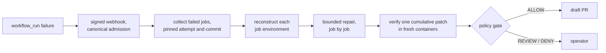
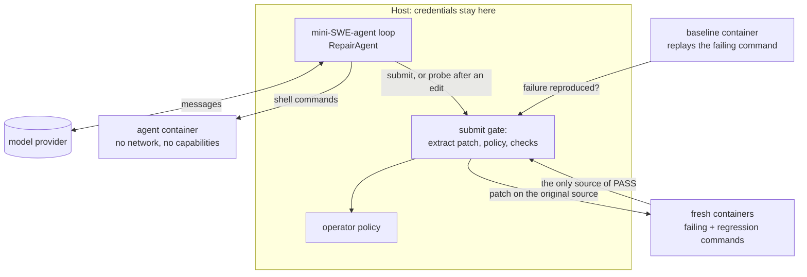

# CI Repair

**An unattended coding agent that turns a failed GitHub Actions run into a verified
draft pull request.**

CI Repair uses mini-SWE-agent to repair failed GitHub Actions runs. It collects
all failed jobs from a pinned run attempt, reconstructs supported CI environments,
repairs them in order, verifies one cumulative patch in fresh Docker containers,
and can create a gated **draft** PR. It never merges automatically.

The agent loop is mini-SWE-agent's. This project is what surrounds it: pinning the
failure, rebuilding its environment, a submit gate the model cannot talk past,
verification the agent does not control, and a policy that decides what may be
published.

## Why

A red CI run interrupts whoever pushed it, and many failures have routine fixes: a
lint rule, a type error, a test broken by a dependency upgrade. A general coding
agent can often write such a fix when a person points it at the failure. Running it
unattended needs what the agent loop does not provide:

- **Which failure, exactly.** The run attempt and commit are pinned, and the repair
  is dropped if the branch has moved on.
- **The CI's environment.** The job is rebuilt from its workflow, and its failure must
  reproduce before any model call is trusted.
- **"Done" is not evidence.** Only the failed jobs' own commands, rerun in fresh
  containers the agent never touched, can make a repair pass.
- **Bounded authority.** Budgets, editable paths and the change categories a person
  must review live in an operator policy outside the repository and outside the model.

The project's question is whether that harness holds up on real failures against a
general agent given the same model and budget. The [results](#results) answer it.

## How it works



Inside one job's repair, the model, the agent's commands and the checks that judge the
result run in separate places:



The model's submission is a request: the gate rejects it with feedback when the
checks fail, and stops the session as soon as a probe passes, so a correct patch is
not overwritten. Jobs of one run are repaired in order on one cumulative patch, and
every job is verified again against the final patch. The
[repair lifecycle](docs/lifecycle.md) covers each step.

| Module | Role |
|---|---|
| `webhook.py` | Signed intake, deduplication, SQLite queue, single worker |
| `github.py` | Read-only collection of a run's failed jobs, logs and pinned source |
| `reconstruct.py` | Workflow → replay spec (`SUPPORTED` / `REVIEW_REQUIRED` / `UNSUPPORTED`) → image |
| `orchestrate.py` | Job order, cumulative patch, final verification, fix-up |
| `pipeline.py`, `agent.py` | One job: baseline, bounded session, submit gate, fresh verification |
| `policy.py` | Budgets and `ALLOW` / `REVIEW` / `DENY` for patches and publication |
| `publish.py` | Creation-only draft PR from a verified run |
| `workspace.py` | Source snapshots and locked-down disposable containers |

## Quickstart

No model key or Docker is needed to run the tests or to recompute the evaluation:

```sh
uv sync --locked
bash scripts/check.sh --unit                # lint, format, 290 tests without Docker
uv run python eval/reproduce.py             # every result table, from eval/results/
```

To repair real failures, see [Run the automatic flow](#run-the-automatic-flow).

## Results

Measured on the [LCA CI builds repair](https://huggingface.co/datasets/JetBrains-Research/lca-ci-builds-repair)
dataset: 39 of its 68 real CI failures (13 repositories) can be replayed offline and
are repaired by their upstream fix; each was attempted three times with
`deepseek/deepseek-flash`, 30 model calls per failed job. [Pi](https://github.com/earendil-works/pi),
a general coding agent, ran on the same tasks, images, model and budget.

| 117 trials (39 tasks × 3) | CI Repair (round 3) | Pi 0.87.1 (round 1) |
|---|---:|---:|
| Patch passes every failed job's checks in fresh containers | 111 (94.9%) | 113 (96.6%) |
| Passing patches that change only files the upstream fix changed | 111 | 112 |
| Passing patches the patch policy allows without review | 74 | 75 |
| Model calls per trial, mean | 8.6 | 11.0 |
| Estimated cost per trial, mean | $0.0058 | $0.0078 |
| Time per trial, mean | 107 s, with verification | 66 s, without |

- A general agent repairs these tasks as well as CI Repair does. What CI Repair adds
  is the path around the repair: it runs unattended from the webhook, accepted
  exactly the 111 patches the external grader passed, and separates what may be
  published automatically from what needs a person.
- Removing redundant verification cut CI Repair's mean time per trial from 227 s to
  107 s (−53%) across iterations on the same tasks, with passes going from 107 to 111.
- These are pass rates on the replayable subset of one Python dataset with one
  model, not a production success rate. Checks are the failed jobs' own commands;
  jobs that passed in the original run are not replayed.

Every number has its run, commit and limits in the [evaluation record](eval/README.md),
and `uv run python eval/reproduce.py --check` recomputes its tables from the archived
evidence in [`eval/results/`](eval/results/README.md);
the [changelog](CHANGELOG.md) records each iteration's motivation, estimate and
measured outcome, including the ones that did not pay off.

## Design trade-offs

- **Reuse the agent loop; build the harness.** mini-SWE-agent's loop is under 200
  lines and works. CI Repair subclasses it (`RepairAgent`) to turn submission
  into a gated request and to report which limit ended a session. The cost is a
  dependency on mini's internals, pinned to 2.4.6.
- **Verification the agent cannot influence.** Every patch is rerun in fresh
  containers from the original source, which costs time on each repair. Removing
  repeated verification later cut the mean time per trial from 227 s to 107 s
  without giving up the rule.
- **Sequential jobs, one cumulative patch.** Jobs of one run often share a cause, so
  each job sees earlier repairs, and a job they already fix is skipped
  (`FIXED_BY_PRIOR`). Parallel sessions would be faster but would produce
  conflicting patches; the final reverification and one fix-up session catch a later
  repair that breaks an earlier job.
- **Fail closed on environments.** A workflow feature the reconstructor does not
  model (services, reusable workflows, `GITHUB_ENV`, non-Linux runners) makes the job
  `UNSUPPORTED` instead of a guess. This limits coverage: 39 of 68 LCA tasks replay.
- **Policy as code, outside the repository.** A pull request cannot edit the rules
  that judge it, and the model never sees them. Changes to tests, lockfiles, CI
  configuration or large patches go to a person (`REVIEW`); merging is always denied.
- **A small service.** Stdlib HTTP, SQLite and one worker per host: nothing else to
  operate, at the price of no horizontal scaling.

## Limitations

- The results come from one Python dataset, its replayable subset, and one model
  (`deepseek/deepseek-flash`). They are pass rates on that subset, not a production
  success rate.
- A general agent repaired these tasks as well (113 against 111 of 117). The project
  demonstrates the unattended path around the repair, not a better repair model.
- 16 of the 19 failed trials are one behaviour: the agent reads the failing code and
  never edits it within 30 calls. A one-time reminder to edit
  ([the intervention](eval/README.md)) was inconclusive (8/12 against 6/12, 4 tasks).
- Jobs that passed in the original run are not replayed, so a patch can break a job
  that verification never runs.
- The live path has one acceptance run on a toy repository. Fixes made after the last
  paid round, such as rechecking a failed job against the final patch
  (`FIXED_BY_LATER`), are tested locally but not measured on the dataset.

## Roadmap

1. Rerun the dataset on the current commit to measure the fixes since round 4.
2. Evaluate on failures outside LCA and with a second model, so the results stop
   depending on one dataset and one provider.
3. Extend reconstruction to the most common `UNSUPPORTED` causes (`GITHUB_ENV`,
   dynamic `fromJSON` matrices, multiple toolchains).
4. Replay the original run's passing jobs as regression checks before publication.

## Status

The [repair lifecycle](docs/lifecycle.md) describes the current system. It is an
alpha: local tests cover the workflow, and one [live acceptance run](docs/acceptance.md)
took a real three-job failure from signed webhook to verified
[draft PR](https://github.com/0xJieREN/ci-repair-acceptance/pull/1) on a toy
repository. Unsupported workflow features fail closed.

## Run the automatic flow

Requires Python 3.12+, [uv](https://docs.astral.sh/uv/), Git,
[GitHub CLI](https://cli.github.com/) authentication, and Docker. On macOS use
Colima for the Docker engine. Keep the operator policy outside every repository
being repaired; keep model credentials private in the ignored `.env` file.

```sh
uv sync --locked
cp -n config/policy.example.yaml ~/ci-repair-policy.yaml
cp -n .env.example .env
# Edit the repository, branch, path, model and budget rules in the policy.
# Put the DeepSeek key in .env; both files must stay private.
export CI_REPAIR_WEBHOOK_SECRET=...  # the GitHub webhook secret
uv run ci-repair-webhook serve --state-dir ~/ci-repair-state \
  --policy ~/ci-repair-policy.yaml --env-file .env
```

Subscribe the GitHub webhook to **Workflow runs**, and put the listener behind
TLS. The example policy sets `publication.draft_pr: ALLOW` for the intentional
fixture. Review permissions and secrets in the target repository's branch
workflows before using it elsewhere; set the gate to `REVIEW` if publication
should require an operator. See [policy](docs/policy.md),
[environment reconstruction](docs/environment.md) and
[publication](docs/pull-requests.md).

The same run can be processed manually without the webhook:

```sh
uv run ci-repair-github OWNER/REPO RUN_ID --output runs/import
uv run ci-repair-run runs/import --policy ~/ci-repair-policy.yaml \
  --env-file .env --output runs/repair
uv run ci-repair-pr auto runs/repair --policy ~/ci-repair-policy.yaml \
  --output runs/publication
```

When the gate says `REVIEW`, an operator approves with
`ci-repair-pr prepare` and `ci-repair-pr publish` (see [publication](docs/pull-requests.md)). The
[GitHub Actions guide](docs/github-actions.md) includes an intentionally failing
fixture for a live collection smoke test.

## Verify changes

```sh
bash scripts/check.sh --unit    # fast checks without Docker
bash scripts/check.sh --colima  # macOS: full gate; stops Colima on exit
bash scripts/check.sh           # Linux/server: full gate with running Docker
```

The full gate runs locked dependency sync, lint and format checks, Docker
integration tests, and Git diff checks. GitHub Actions uses the same script.
No model API key or paid inference is needed. See
[verification boundaries](docs/verification.md) for what local tests simulate, and
[CONTRIBUTING](CONTRIBUTING.md) for the developer guide.

The repository retains the deliberately broken `examples/buggy` fixture because
the local repair tests and manual GitHub workflow use it. Local run outputs and
`.env` are Git-ignored. `config/deepseek-pricing.json` provides estimates, not
provider billing receipts. The [changelog](CHANGELOG.md) records each version:
motivation, changes, verification evidence and known limits; retired code and
data remain retrievable from Git history.
